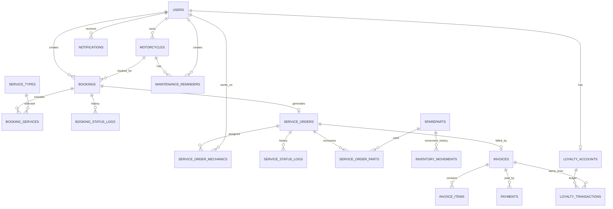

# MotoCare — Final Database Architecture

**Project:** MotoCare  
**Source:** MotoCare – Kelompok 2 presentation (12 pages) and the business-rule decisions supplied afterward  
**Database style:** Relational database  
**Recommended implementation:** MySQL 8+ or PostgreSQL, with Laravel migrations and Eloquent models

## 1. Architecture summary

MotoCare is a workshop management system with customer-facing booking and service tracking, plus internal workshop, inventory, billing, and customer-retention workflows.

The database is organized into these modules:

1. Identity and vehicle profiles
2. Service catalog and bookings
3. Workshop execution and status history
4. Spareparts and inventory
5. Invoices and payments
6. Manual maintenance reminders and notifications
7. Loyalty points

### Confirmed business rules

| Area | Confirmed rule | Database consequence |
|---|---|---|
| Vehicles | One customer account can register up to 5 motorcycles | Enforce a maximum of 5 active motorcycle profiles per user in application logic, with a transaction/locking strategy |
| Booking services | One booking can contain multiple service types | `bookings` to `service_types` is many-to-many through `booking_services` |
| Rescheduling | Customers can reschedule | Keep booking status and booking history; update scheduled date/time |
| Cancellation | Customers can cancel any time before servicing starts | Permit cancellation while booking has not progressed into an active service order |
| Mechanics | Multiple mechanics can work on one service | Many-to-many `service_orders` and `users` through `service_order_mechanics` |
| Estimate approval | Customer approval is not part of the required workflow | No mandatory estimate-approval state in the core workflow |
| Payments | Large services may use 50% upfront and 50% after completion | Support multiple payments per invoice and a configurable deposit on each invoice |
| Prices | Service and sparepart prices are editable | Store current catalog prices and immutable price snapshots on order/invoice records |
| Loyalty | Points are based on spending | Record eligible spending and points earned; conversion rate remains configurable |
| Reminders | Reminders are created manually | Store manually entered date and/or odometer due conditions; do not assume automatic prediction |

### Important unresolved configuration values

These values were not specified and should remain configurable rather than being invented:

- What invoice amount qualifies as a “large” service.
- Whether the 50% deposit is mandatory or optional for a particular invoice.
- The loyalty conversion rate (for example, how much spending earns one point).
- Whether loyalty points can be redeemed, and the redemption rules.
- The exact service booking time-slot and workshop capacity rules.
- Whether customers can edit a booking after the workshop has accepted it.

## 2. Entity relationship diagram

The diagram shows the core relationships. Audit columns, optional references, and some operational constraints are described below.

## 3. Table specification

Use `BIGINT` primary keys (or Laravel `id()`), `created_at` and `updated_at` timestamps on mutable records, and `DECIMAL` for money. Never use floating-point types for currency.

### A. Identity and vehicle profiles

#### `users`

Stores customer and staff accounts.

| Column | Suggested type | Rules |
|---|---|---|
| `id` | BIGINT | PK |
| `name` | VARCHAR(150) | Required |
| `email` | VARCHAR(255) | Required, unique |
| `phone` | VARCHAR(30) | Nullable; index if used for lookup |
| `password` | VARCHAR(255) | Required; store a password hash |
| `role` | VARCHAR(30) | Required; customer, admin, mechanic, inventory_staff, cashier, owner |
| `is_active` | BOOLEAN | Default true |
| `email_verified_at` | TIMESTAMP | Nullable |
| `created_at`, `updated_at` | TIMESTAMP | Required |

Role authorization should be enforced by the application/policies, not only by hiding interface elements.

#### `motorcycles`

Stores motorcycles registered by customers.

| Column | Suggested type | Rules |
|---|---|---|
| `id` | BIGINT | PK |
| `user_id` | BIGINT | FK → `users.id` |
| `brand` | VARCHAR(100) | Required |
| `model` | VARCHAR(100) | Required |
| `year` | SMALLINT | Nullable |
| `license_plate` | VARCHAR(20) | Nullable; unique if present, subject to business policy |
| `odometer_current` | INT UNSIGNED | Default 0; latest known reading |
| `notes` | TEXT | Nullable |
| `created_at`, `updated_at` | TIMESTAMP | Required |

**Constraint:** maximum 5 active motorcycles per customer. Enforce this in a database transaction in the application. A simple row count without locking can allow concurrent requests to exceed the limit.

### B. Service catalog and bookings

#### `service_types`

Catalog of services offered by the workshop.

| Column | Suggested type | Rules |
|---|---|---|
| `id` | BIGINT | PK |
| `name` | VARCHAR(150) | Required |
| `description` | TEXT | Nullable |
| `base_price` | DECIMAL(12,2) | Required, default 0 |
| `estimated_duration_minutes` | INT UNSIGNED | Nullable |
| `is_active` | BOOLEAN | Default true |
| `created_at`, `updated_at` | TIMESTAMP | Required |

Catalog price is editable. Historical booking/order/invoice prices must be snapshots and must not change when this catalog value changes.

#### `bookings`

One customer appointment for one motorcycle. A booking may contain multiple selected service types.

| Column | Suggested type | Rules |
|---|---|---|
| `id` | BIGINT | PK |
| `booking_number` | VARCHAR(40) | Required, unique |
| `user_id` | BIGINT | FK → `users.id` |
| `motorcycle_id` | BIGINT | FK → `motorcycles.id` |
| `scheduled_at` | TIMESTAMP | Required |
| `status` | VARCHAR(30) | Required |
| `customer_note` | TEXT | Nullable |
| `cancelled_at` | TIMESTAMP | Nullable |
| `cancellation_reason` | TEXT | Nullable |
| `created_at`, `updated_at` | TIMESTAMP | Required |

Suggested booking statuses:

- `pending`
- `confirmed`
- `rescheduled` (optional if rescheduling is represented as a history event while status remains confirmed)
- `cancelled`
- `checked_in`
- `converted_to_service`
- `no_show`

Keep the current scheduled time in `scheduled_at`. Record every reschedule in `booking_status_logs` or a dedicated booking event table.

#### `booking_services`

Pivot table for services selected for a booking.

| Column | Suggested type | Rules |
|---|---|---|
| `id` | BIGINT | PK |
| `booking_id` | BIGINT | FK → `bookings.id` |
| `service_type_id` | BIGINT | FK → `service_types.id` |
| `price_snapshot` | DECIMAL(12,2) | Required |
| `duration_snapshot_minutes` | INT UNSIGNED | Nullable |
| `created_at`, `updated_at` | TIMESTAMP | Required |

Add a unique constraint on (`booking_id`, `service_type_id`) unless the business explicitly permits selecting the same service more than once in one booking.

#### `booking_status_logs`

Records booking changes, including rescheduling and cancellation.

| Column | Suggested type | Rules |
|---|---|---|
| `id` | BIGINT | PK |
| `booking_id` | BIGINT | FK → `bookings.id` |
| `changed_by` | BIGINT | FK → `users.id`; nullable for system events |
| `old_status` | VARCHAR(30) | Nullable for initial event |
| `new_status` | VARCHAR(30) | Required |
| `old_scheduled_at` | TIMESTAMP | Nullable |
| `new_scheduled_at` | TIMESTAMP | Nullable |
| `reason` | TEXT | Nullable |
| `created_at` | TIMESTAMP | Required |

A customer may cancel before servicing starts. The application should reject cancellation once the related service order has entered active work. The exact operational boundary should be implemented consistently (recommended: cancellation is allowed until check-in/service-order start).

### C. Workshop execution

#### `service_orders`

Represents actual work performed by the workshop. A booking is an appointment; a service order is the workshop job created when the motorcycle is checked in.

| Column | Suggested type | Rules |
|---|---|---|
| `id` | BIGINT | PK |
| `work_order_number` | VARCHAR(40) | Required, unique |
| `booking_id` | BIGINT | FK → `bookings.id`, unique; nullable only if walk-ins are supported |
| `motorcycle_id` | BIGINT | FK → `motorcycles.id` |
| `customer_id` | BIGINT | FK → `users.id` |
| `odometer_in` | INT UNSIGNED | Required |
| `odometer_out` | INT UNSIGNED | Nullable |
| `status` | VARCHAR(40) | Required |
| `diagnosis` | TEXT | Nullable |
| `work_notes` | TEXT | Nullable |
| `checked_in_at` | TIMESTAMP | Required |
| `started_at` | TIMESTAMP | Nullable |
| `completed_at` | TIMESTAMP | Nullable |
| `picked_up_at` | TIMESTAMP | Nullable |
| `created_at`, `updated_at` | TIMESTAMP | Required |

Suggested service order statuses based on the presentation:

1. `waiting_queue`
2. `being_inspected`
3. `in_progress`
4. `completed`
5. `picked_up`

The presentation also mentions “waiting for customer approval.” Since the confirmed decision says approval is not required, that status is excluded from the required workflow. It can be added later if the business introduces optional estimate approval.

#### `service_order_mechanics`

Allows multiple mechanics to work on one service order.

| Column | Suggested type | Rules |
|---|---|---|
| `id` | BIGINT | PK |
| `service_order_id` | BIGINT | FK → `service_orders.id` |
| `mechanic_id` | BIGINT | FK → `users.id` |
| `assignment_role` | VARCHAR(30) | Nullable; e.g. lead, assistant |
| `assigned_at` | TIMESTAMP | Required |
| `unassigned_at` | TIMESTAMP | Nullable |
| `created_at`, `updated_at` | TIMESTAMP | Required |

Do not store multiple mechanic IDs in one column. Add a unique constraint for the active assignment combination as appropriate for the selected database.

#### `service_status_logs`

Immutable history of service status transitions.

| Column | Suggested type | Rules |
|---|---|---|
| `id` | BIGINT | PK |
| `service_order_id` | BIGINT | FK → `service_orders.id` |
| `changed_by` | BIGINT | FK → `users.id`; nullable for system events |
| `old_status` | VARCHAR(40) | Nullable for initial event |
| `new_status` | VARCHAR(40) | Required |
| `notes` | TEXT | Nullable |
| `created_at` | TIMESTAMP | Required |

The current status belongs in `service_orders.status`; the log preserves the full timeline. Update the current status and insert the log in the same database transaction.

### D. Spareparts and inventory

#### `spareparts`

Stores sparepart catalog and current stock summary.

| Column | Suggested type | Rules |
|---|---|---|
| `id` | BIGINT | PK |
| `sku` | VARCHAR(80) | Required, unique |
| `name` | VARCHAR(180) | Required |
| `description` | TEXT | Nullable |
| `unit` | VARCHAR(30) | Required; e.g. pcs, bottle |
| `unit_price` | DECIMAL(12,2) | Required |
| `stock_quantity` | INT | Required, default 0 |
| `minimum_stock` | INT UNSIGNED | Default 0 |
| `is_active` | BOOLEAN | Default true |
| `created_at`, `updated_at` | TIMESTAMP | Required |

`stock_quantity` is a convenient current balance. `inventory_movements` is the audit ledger. Both must be updated atomically.

#### `motorcycle_compatibility`

Associates spareparts with compatible motorcycle models.

| Column | Suggested type | Rules |
|---|---|---|
| `id` | BIGINT | PK |
| `sparepart_id` | BIGINT | FK → `spareparts.id` |
| `brand` | VARCHAR(100) | Required |
| `model` | VARCHAR(100) | Required |
| `year_from` | SMALLINT | Nullable |
| `year_to` | SMALLINT | Nullable |

Add an index on (`brand`, `model`). If a normalized motorcycle model catalog is introduced later, replace the text model fields with a foreign key.

#### `service_order_parts`

Records spareparts consumed by a service order, including the price at the time of use.

| Column | Suggested type | Rules |
|---|---|---|
| `id` | BIGINT | PK |
| `service_order_id` | BIGINT | FK → `service_orders.id` |
| `sparepart_id` | BIGINT | FK → `spareparts.id` |
| `quantity` | INT UNSIGNED | Required, greater than 0 |
| `unit_price_snapshot` | DECIMAL(12,2) | Required |
| `inventory_movement_id` | BIGINT | FK → `inventory_movements.id`; nullable until stock issue is posted |
| `created_at`, `updated_at` | TIMESTAMP | Required |

#### `inventory_movements`

Audit trail for stock received, consumed, or corrected.

| Column | Suggested type | Rules |
|---|---|---|
| `id` | BIGINT | PK |
| `sparepart_id` | BIGINT | FK → `spareparts.id` |
| `movement_type` | VARCHAR(20) | `in`, `out`, `adjustment` |
| `quantity` | INT UNSIGNED | Required, greater than 0 |
| `quantity_before` | INT | Required |
| `quantity_after` | INT | Required |
| `reference_type` | VARCHAR(40) | Nullable; e.g. service_order_part, stock_receipt |
| `reference_id` | BIGINT | Nullable; application-level reference |
| `performed_by` | BIGINT | FK → `users.id` |
| `notes` | TEXT | Nullable |
| `created_at` | TIMESTAMP | Required |

For `adjustment`, store the direction explicitly (or use a signed delta design consistently). Never silently edit historical movement rows. Corrections should create a new adjustment movement.

### E. Invoices and payments

#### `invoices`

One invoice per service order in the initial design.

| Column | Suggested type | Rules |
|---|---|---|
| `id` | BIGINT | PK |
| `invoice_number` | VARCHAR(40) | Required, unique |
| `service_order_id` | BIGINT | FK → `service_orders.id`, unique |
| `subtotal` | DECIMAL(12,2) | Required |
| `discount_amount` | DECIMAL(12,2) | Default 0 |
| `tax_amount` | DECIMAL(12,2) | Default 0 |
| `total_amount` | DECIMAL(12,2) | Required |
| `deposit_required` | BOOLEAN | Default false |
| `deposit_percentage` | DECIMAL(5,2) | Nullable; 50.00 when the 50% deposit option is selected |
| `deposit_amount` | DECIMAL(12,2) | Nullable |
| `paid_amount` | DECIMAL(12,2) | Default 0; maintained transactionally |
| `remaining_amount` | DECIMAL(12,2) | Default 0; maintained transactionally or calculated |
| `payment_status` | VARCHAR(20) | `unpaid`, `partially_paid`, `paid`, `refunded`, `void` |
| `issued_at` | TIMESTAMP | Nullable |
| `created_at`, `updated_at` | TIMESTAMP | Required |

The 50% deposit is a supported option for large services, not a universal rule. Since the definition of “large” is unspecified, the cashier/admin should select whether a deposit applies and the application should default its percentage to 50%. Keep the percentage and amount as invoice snapshots.

#### `invoice_items`

Stores the exact billed line items and price snapshots.

| Column | Suggested type | Rules |
|---|---|---|
| `id` | BIGINT | PK |
| `invoice_id` | BIGINT | FK → `invoices.id` |
| `item_type` | VARCHAR(20) | `service`, `sparepart`, `other` |
| `description` | VARCHAR(255) | Required snapshot |
| `quantity` | DECIMAL(12,2) | Required, greater than 0 |
| `unit_price` | DECIMAL(12,2) | Required snapshot |
| `line_total` | DECIMAL(12,2) | Required |
| `service_type_id` | BIGINT | Nullable FK → `service_types.id` |
| `sparepart_id` | BIGINT | Nullable FK → `spareparts.id` |
| `created_at`, `updated_at` | TIMESTAMP | Required |

The description and unit price are snapshots. Catalog edits must never rewrite historical invoice items.

#### `payments`

Allows one invoice to receive multiple payments, including a deposit and final settlement.

| Column | Suggested type | Rules |
|---|---|---|
| `id` | BIGINT | PK |
| `invoice_id` | BIGINT | FK → `invoices.id` |
| `payment_reference` | VARCHAR(60) | Required, unique |
| `amount` | DECIMAL(12,2) | Required, greater than 0 |
| `payment_method` | VARCHAR(30) | e.g. cash, transfer, QRIS; confirm supported methods |
| `payment_status` | VARCHAR(20) | `pending`, `paid`, `failed`, `refunded` |
| `received_by` | BIGINT | FK → `users.id`; nullable for external gateway |
| `paid_at` | TIMESTAMP | Nullable |
| `notes` | TEXT | Nullable |
| `created_at`, `updated_at` | TIMESTAMP | Required |

Update payment records and invoice totals in a database transaction. Only successful/paid payments should contribute to `paid_amount`. Define refund handling before implementing live payments.

### F. Manual maintenance reminders and notifications

#### `maintenance_reminders`

Reminders are manually created by authorized staff (or another explicitly permitted user role). The system does not automatically calculate or generate the next service schedule in this version.

| Column | Suggested type | Rules |
|---|---|---|
| `id` | BIGINT | PK |
| `motorcycle_id` | BIGINT | FK → `motorcycles.id` |
| `created_by` | BIGINT | FK → `users.id` |
| `title` | VARCHAR(180) | Required |
| `description` | TEXT | Nullable |
| `due_date` | DATE | Nullable |
| `due_odometer` | INT UNSIGNED | Nullable |
| `status` | VARCHAR(20) | `scheduled`, `sent`, `completed`, `cancelled` |
| `sent_at` | TIMESTAMP | Nullable |
| `created_at`, `updated_at` | TIMESTAMP | Required |

Require at least one of `due_date` or `due_odometer`. Both may be provided. Manual means a user creates the reminder; the application may still check due conditions and send a notification if that behavior is implemented.

#### `notifications`

In-app notification records.

| Column | Suggested type | Rules |
|---|---|---|
| `id` | BIGINT | PK |
| `user_id` | BIGINT | FK → `users.id` |
| `title` | VARCHAR(180) | Required |
| `message` | TEXT | Required |
| `type` | VARCHAR(40) | Required; e.g. booking_update, service_update, reminder, payment |
| `related_type` | VARCHAR(40) | Nullable |
| `related_id` | BIGINT | Nullable |
| `read_at` | TIMESTAMP | Nullable |
| `created_at`, `updated_at` | TIMESTAMP | Required |

If email, WhatsApp, or push notifications are later added, consider a separate delivery log with channel, attempt status, and provider response.

### G. Loyalty points

#### `loyalty_accounts`

One loyalty account per customer.

| Column | Suggested type | Rules |
|---|---|---|
| `id` | BIGINT | PK |
| `user_id` | BIGINT | FK → `users.id`, unique |
| `points_balance` | BIGINT | Default 0 |
| `membership_level` | VARCHAR(30) | Default `standard`; tiers require business rules |
| `created_at`, `updated_at` | TIMESTAMP | Required |

#### `loyalty_transactions`

Ledger of points earned, redeemed, or adjusted.

| Column | Suggested type | Rules |
|---|---|---|
| `id` | BIGINT | PK |
| `loyalty_account_id` | BIGINT | FK → `loyalty_accounts.id` |
| `invoice_id` | BIGINT | Nullable FK → `invoices.id` |
| `transaction_type` | VARCHAR(20) | `earn`, `redeem`, `adjustment` |
| `eligible_spend` | DECIMAL(12,2) | Nullable |
| `conversion_rate_snapshot` | DECIMAL(12,4) | Nullable |
| `points` | BIGINT | Signed delta: positive for earned, negative for redeemed |
| `description` | VARCHAR(255) | Nullable |
| `created_by` | BIGINT | FK → `users.id`; nullable for system event |
| `created_at` | TIMESTAMP | Required |

The selected rule is spending-based, but the conversion rate is undecided. Store the rate used for each earning transaction so future rule changes do not alter historical points. Award points only according to a clearly defined policy (recommended: after the invoice is fully paid). Redemption is structurally supported but must remain disabled until its rules are decided.

## 4. Core workflow and transaction boundaries

### Booking

1. Customer selects a motorcycle.
2. Customer selects one or more service types.
3. System snapshots the selected service prices and estimated durations.
4. Customer selects an available date/time.
5. Booking is created with `pending` or `confirmed` status according to the workshop's confirmation policy.
6. Rescheduling updates `scheduled_at` and inserts a booking history record.
7. Cancellation is permitted before servicing starts and is recorded in booking history.

### Check-in and workshop service

1. Staff checks in the motorcycle and records `odometer_in`.
2. System creates a service order linked to the booking.
3. Staff assigns one or more mechanics.
4. Mechanics update the service order status.
5. Every status transition is recorded in `service_status_logs`.
6. Spareparts used are recorded in `service_order_parts`; stock and inventory movement are updated atomically.
7. On completion, record `completed_at` and create/finalize the invoice.
8. When the customer collects the motorcycle, record `picked_up_at`.

### Billing and partial payments

1. Create invoice items from labor/service charges, spareparts, and any other charges.
2. Preserve description, quantity, and unit price snapshots.
3. If a deposit is required, set the invoice deposit percentage to 50% by default.
4. Record each payment as a separate row.
5. Recalculate paid and outstanding amounts in the same transaction.
6. Mark the invoice paid when successful payments cover the invoice total.

### Loyalty

1. Determine eligible spending using the chosen loyalty policy.
2. Apply the configured spending-to-points conversion rate.
3. Insert a loyalty ledger transaction with the rate snapshot.
4. Update the account balance in the same transaction.
5. Do not allow redemption until redemption rules have been approved.

### Manual maintenance reminder

1. Authorized staff creates a reminder for a motorcycle.
2. Staff enters a due date, due odometer, or both.
3. The reminder is stored with its creator and status.
4. The application may notify the customer when the manually entered condition is reached.

## 5. Critical integrity rules

1. A motorcycle must belong to the customer associated with the booking/service order.
2. A customer may have at most 5 active motorcycle profiles.
3. A booking may contain multiple distinct service types.
4. A booking can generate at most one service order in the initial design.
5. A service order may have multiple mechanic assignments.
6. A service order cannot be cancelled as a booking once work has started.
7. Status changes must update the current record and append a history record atomically.
8. Stock must never be deducted without a corresponding inventory movement.
9. Stock quantity must not become negative unless the workshop explicitly chooses to allow backorders.
10. Invoice line prices must remain unchanged when catalog prices are edited.
11. Payments must not cause the paid amount to exceed the invoice total unless overpayments are explicitly supported.
12. Only paid payments count toward the invoice paid balance.
13. Loyalty points must be traceable to their source invoice or an authorized adjustment.
14. Reminder records must contain at least one due condition: date or odometer.
15. Use foreign keys and deliberate delete behavior. Prefer soft deletion or deactivation for catalog and user records referenced by history.

## 6. Recommended indexes and constraints

- `users.email`: UNIQUE.
- `motorcycles.user_id`: INDEX.
- `motorcycles.license_plate`: UNIQUE if the business requires globally unique plates and null handling is correct for the chosen DB.
- `bookings.booking_number`: UNIQUE.
- `bookings(user_id, scheduled_at)`: INDEX.
- `bookings(status, scheduled_at)`: INDEX.
- `booking_services(booking_id, service_type_id)`: UNIQUE.
- `booking_status_logs(booking_id, created_at)`: INDEX.
- `service_orders.work_order_number`: UNIQUE.
- `service_orders.booking_id`: UNIQUE.
- `service_orders(status, created_at)`: INDEX.
- `service_order_mechanics(service_order_id, mechanic_id)`: INDEX; enforce one active assignment per pair.
- `service_status_logs(service_order_id, created_at)`: INDEX.
- `spareparts.sku`: UNIQUE.
- `spareparts(name)`: INDEX if catalog search requires it.
- `inventory_movements(sparepart_id, created_at)`: INDEX.
- `service_order_parts(service_order_id)`: INDEX.
- `invoices.invoice_number`: UNIQUE.
- `invoices.service_order_id`: UNIQUE.
- `payments.payment_reference`: UNIQUE.
- `payments(invoice_id, payment_status)`: INDEX.
- `maintenance_reminders(motorcycle_id, status, due_date)`: INDEX.
- `notifications(user_id, read_at, created_at)`: INDEX.
- `loyalty_accounts.user_id`: UNIQUE.
- `loyalty_transactions(loyalty_account_id, created_at)`: INDEX.
- `loyalty_transactions.invoice_id`: INDEX.

Add CHECK constraints where supported for positive quantities, non-negative amounts, valid percentage ranges, and reminder due conditions. Also validate these rules in Laravel request validation and domain services.

## 7. Security and implementation guidance

- Hash passwords using Laravel's supported password hashing facilities.
- Enforce role permissions with policies/middleware and server-side authorization.
- Validate ownership: customers must only access their own motorcycles, bookings, invoices, reminders, and notifications.
- Use database transactions for booking creation, status changes, inventory deductions, invoice/payment updates, and loyalty point awards.
- Use row-level locking (`SELECT ... FOR UPDATE` or the framework equivalent) when updating stock, balances, or enforcing the five-motorcycle limit under concurrent requests.
- Keep payment gateway secrets and credentials outside the repository.
- Never store raw card details or payment credentials.
- Use soft deletes/deactivation for records that are part of financial or service history.
- Keep timestamps in UTC in storage and display them in the workshop's local timezone.
- Add automated tests for cancellation boundaries, multiple mechanics, partial payments, stock concurrency, price snapshots, and loyalty calculations.

## 8. Suggested Laravel model list

- `User`
- `Motorcycle`
- `ServiceType`
- `Booking`
- `BookingService`
- `BookingStatusLog`
- `ServiceOrder`
- `ServiceOrderMechanic`
- `ServiceStatusLog`
- `Sparepart`
- `MotorcycleCompatibility`
- `ServiceOrderPart`
- `InventoryMovement`
- `Invoice`
- `InvoiceItem`
- `Payment`
- `MaintenanceReminder`
- `Notification`
- `LoyaltyAccount`
- `LoyaltyTransaction`

Use singular PascalCase model names and plural snake_case table names. Define explicit relationships in Eloquent and keep business rules in services/actions rather than controllers.

## 9. Suggested implementation order

1. Users and motorcycles.
2. Service types and booking workflow.
3. Booking history and service orders.
4. Mechanic assignment and service status history.
5. Spareparts, compatibility, and inventory movements.
6. Invoices, invoice items, and partial payments.
7. Manual reminders and notifications.
8. Loyalty accounts and transactions.
9. Authorization, audit coverage, indexes, and integration tests.

## 10. Decisions still required before production

The core architecture is defined, but these are configuration/business-policy decisions rather than blockers to creating the initial schema:

- Define the monetary threshold for a “large” service, or let staff choose deposit-required per invoice.
- Confirm whether the 50% deposit is always required when selected.
- Set the loyalty conversion rate (spending amount per point).
- Define whether points are earned on the full invoice total or only the amount actually paid; recommended: award after full payment.
- Define redemption value, eligibility, and expiry before enabling point redemption.
- Confirm whether walk-in service orders without a booking are allowed. The proposed `service_orders.booking_id` is nullable to support this if desired.
- Confirm booking slot capacity and whether staff must confirm bookings.
- Confirm payment methods and refund workflow.

---

**Status:** Architecture ready for initial ERD review and Laravel migration planning. It is a proposed design based on the presentation and decisions above, not a claim that every operational policy has already been finalized.
